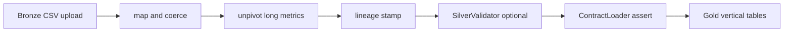
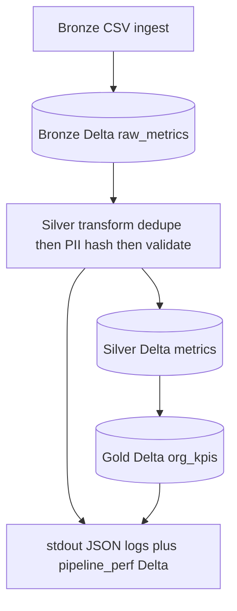

# Pipeline governance helpers

Ambient Core ships **contracts**, **catalog** semantics, a **pandas notebook path** (`ambient_pipeline.notebook_smoke`), and optional Spark/Delta helpers under `lib/ambient_pipeline/`. It does **not** require Databricks. The fictional sample lives in [`examples/sample/`](../examples/sample/). Notebook entry: [`notebooks/00_notebook_demo.ipynb`](../notebooks/00_notebook_demo.ipynb). Job definitions and deploy bindings belong in your application repository.

For catalog vs contracts and path env vars, see [governed-data.md](governed-data.md). Product inventory and catalog linkage: [contracts/README.md](../contracts/README.md). For pinning core in a monorepo, see [INTEGRATING.md](INTEGRATING.md). Bronze uploads use **CSV/TSV** at the ingestion boundary; governed Gold output is typically **Parquet/Delta** in your lakehouse — see [CONVENTIONS.md](CONVENTIONS.md#data-formats-and-storage).

**Boundary:** the **catalog** (manifest v3 and data options) defines upload field names, types, and mapping rules; **contracts** define the publishable Silver/Gold product shape that jobs must satisfy before write.

## What lives where

**In this repository:** `contracts/*.yaml`; `catalog/` + `manifest.json`; pandas and Spark helpers under `lib/ambient_pipeline/`; notebooks (`00_notebook_demo.ipynb`); the sample under `examples/sample/`; `validate-contracts` and the catalog generator CLIs.

**In your application repository:** job definitions and orchestration; upload UX; document-store sync and OLAP queries; CI that calls the same CLIs.

Pipeline run logs in this repository are structured events from `ambient_pipeline.pipeline_logging`. They are not a separate data-product contract.

## Install and test

```bash
git clone <repository-url>
cd ambient-core
pip install -e ".[pipeline,dev]"
set AMBIENT_SPARK_TESTS=1 # Windows; use export on Unix
pytest tests/pipeline/
python scripts/run_oss_bronze_silver_smoke.py
```

Java 17+ is required for Spark tests. Prefer the pandas notebook smoke (`ambient_pipeline.notebook_smoke`) with [`examples/sample/`](../examples/sample/). The optional Spark script maps `examples/sample/inventory-records.csv` through Bronze → Silver with local Delta under `.lakehouse/smoke/`. The catalog option key remains `Allmanufacturingds-inventory-records`.

**Packaging note:** The published wheel includes `ambient_contracts`, `ambient_cli`, `ambient_calc`, `ambient_statements`, and `ambient_pipeline`. Notebooks call `ambient_pipeline.notebook_bootstrap.ensure_pipeline_on_path()` so a git checkout resolves `lib/`.

## Typical job flow (Bronze → Silver tenant-metrics)

The steps below implement precursor → plain-text extract → YAML-governed → forward store for **Silver** [`tenant-metrics-v1.yaml`](../contracts/tenant-metrics-v1.yaml). Gold vertical products are a separate step — see [Silver → Gold](#silver-gold-catalog-calc-and-vertical-contracts).



**Canonical order:** map → coerce → **unpivot** → stamp → (optional validate) → contract assert → write Silver.

**Anti-pattern:** stamping provenance on **wide** mapped rows **before** unpivot. `unpivot_to_tenant_metrics` uses `stack()` and does not carry `_bronze_*` columns from a wide frame — stamp **after** unpivot (or call [`bronze_to_tenant_metrics`](../lib/ambient_pipeline/bronze_catalog_map.py) which encodes this order).

1. **Resolve contract** — `ContractLoader.load("tenant-metrics-v1.yaml")`. Call `enforce_bronze_lineage()` before writes that depend on bronze provenance columns.
2. **Map uploads to catalog shape** — `apply_column_mapping`, then `coerce_mapped_columns` with manifest v3 types from `catalog_types_for_option()` ([catalog_field_rules.py](../lib/ambient_pipeline/catalog_field_rules.py)).
3. **Unpivot to long metrics** — `unpivot_to_tenant_metrics` turns numeric catalog fields into `name` / `value` rows with stable `metric_id`.
4. **Stamp lineage** — `stamp_lineage_columns` (or `BronzeProvenanceStamper` on the long DataFrame) sets `_bronze_org_id` from `org_id`, `_bronze_row_hash`, and mapping metadata ([provenance.py](../lib/ambient_pipeline/provenance.py)).
5. **Validate Silver quality (optional)** — `SilverValidator` applies ISO 8000–style checks ([validation.py](../lib/ambient_pipeline/validation.py)).
6. **Assert schema** — `ContractLoader.assert_required_columns()` on the column set before publish.

**Orchestration helper:** `bronze_to_tenant_metrics(...)` runs steps 2–4 in order. See [tests/pipeline/test_bronze_to_tenant_metrics_contract.py](../tests/pipeline/test_bronze_to_tenant_metrics_contract.py).

Document-store sync belongs in your application repository (not shipped here). Secrets prefer environment variables; Databricks `dbutils` is optional when present.

## Silver → Gold (catalog, calc, and vertical contracts)

Ambient Core **does not** ship Spark jobs that write `finance-*-v1` or healthcare Gold tables. Recommended pattern in the consuming application:

1. Read Silver long metrics from `tenant-metrics-v1` shape (or query your lakehouse Silver table).
2. Evaluate catalog formulas with [`ambient_calc`](../lib/ambient_calc/__init__.py) (`compute_all` on manifest metrics + measured inputs).
3. Use [`catalog/crosswalk.yaml`](../catalog/crosswalk.yaml) and [`gold_contract_map`](../lib/ambient_pipeline/gold_contract_map.py) to relate manifest metric keys to Gold contract columns.
4. Pivot or join into the target product schema (for example [`finance-banking-v1.yaml`](../contracts/finance-banking-v1.yaml)), then `ContractLoader.assert_required_columns()` on that product before write.

Details: [contracts/README.md](../contracts/README.md), [crosswalk.md](crosswalk.md).

### Local Spark runner — medallion data flow

The optional helper [`ambient_pipeline.runner`](../lib/ambient_pipeline/runner.py) (`run_local_pipeline` / `run_pipeline_from_config`) runs a simplified Bronze → Silver → Gold path for OSS scale tests. Structured JSON logs go to stdout via [`log_pipeline_event`](../lib/ambient_pipeline/pipeline_logging.py) at pipeline start and after each stage; stage timings and row counts are also written under `gold/pipeline_perf` (Delta) by `PipelinePerfRecorder`.



PII matching columns (for example `name`) are pseudonymized **after** Bronze read and **before** Silver write. Gold pivots Real Estate KPIs on stable **`metric_id`** when present so display names can be hashed in Silver without breaking the wide table.

### Local Spark PII salt {#local-spark-pii-salt}

`run_local_pipeline` calls `PiiPseudonymizer` during Silver transformation. Outside pytest or `AMBIENT_SPARK_TESTS=1`, **`AMBIENT_PII_SALT` must be set** to a non-empty value that is **not** the golden integration-test salt (`golden-test-salt-not-for-production`).

**Setup (local lakehouse):**

1. Copy [`.env.example`](../.env.example) to `.env.local` (gitignored) or export variables in your shell.
2. Replace the `AMBIENT_PII_SALT` placeholder with a long random string unique to your machine or tenant.
3. Install Spark extras: `pip install -e ".[pipeline]"` (or `.[all]`).
4. Run with Java 17+ and `AMBIENT_SPARK_TESTS=1 pytest tests/pipeline/` for the full gated suite, or invoke `run_local_pipeline` from your own driver with the env var set.

**Typical error (missing salt):**

```text
RuntimeError: PiiPseudonymizer requires AMBIENT_PII_SALT outside test runs. Set AMBIENT_PII_SALT to a unique non-empty value ...
```

**Fix:** `export AMBIENT_PII_SALT='your-unique-local-salt'` (or load from `.env.local` before starting Spark). Do not use the golden test value or an empty string.

`AMBIENT_ALLOW_DEV_SECRETS=1` alone does **not** satisfy this check; the env var must still be set for pseudonymization. Pandas notebook smoke paths do not use this Spark pseudonymizer.

### Local Spark runner — real-estate gold columns

The runner writes a simplified **real-estate** Gold Delta table when Silver rows include `industry` and (`metric_id` or `name`) and at least one row has `industry == "Real Estate"`. When `metric_id` is present, pivot keys are catalog ids (`re-noi`, `re-ads`, `re-mv`) mapped to Delta-safe Gold columns. Legacy rows without `metric_id` still pivot on human-readable **display names** (renamed because Delta rejects spaces).

`metric_id` (preferred pivot) or display name (`name`) maps to Gold column:

- **re-noi** / Net Operating Income → `noi`
- **re-ads** / Annual Debt Service → `annual_debt_service`
- **re-mv** / Market Value → `market_value`

The runner also adds **`kpi_dscr`** (`noi / annual_debt_service` when debt service is positive). Constants live in `REAL_ESTATE_GOLD_PIVOT_BY_METRIC_ID` and `REAL_ESTATE_GOLD_PIVOT` in `runner.py`. When `name` / `industry` are absent, Gold falls back to a per-org **summary** table (`metric_rows`, optional `distinct_metrics`) under `gold/org_kpis/summary`.

Spark integration coverage uses temporary CSV fixtures in [`test_runner_local_pipeline.py`](../tests/test_runner_local_pipeline.py) and [`test_gold_transform_edges.py`](../tests/pipeline/test_gold_transform_edges.py); pytest or ``AMBIENT_SPARK_TESTS=1`` enables the well-known blocked salt constant in `lib/ambient_pipeline/pii.py`.

Public re-exports from `ambient_pipeline`: `ContractLoader`, `BronzeProvenanceStamper`, `PiiPseudonymizer`, `SilverValidator`, plus `bronze_to_tenant_metrics`, `MappingSpec`, and mapping helpers ([`__init__.py`](../lib/ambient_pipeline/__init__.py)).

## Walkthrough by test module

Use these as executable recipes (run with `AMBIENT_SPARK_TESTS=1` where Spark is involved):

- [test_contracts.py](../tests/pipeline/test_contracts.py) — load tenant-metrics contract; bronze lineage enforcement; required columns
- [test_bronze_catalog_map.py](../tests/pipeline/test_bronze_catalog_map.py) — mapping JSON, CSV header validation, stable metric ids, coercion
- [test_bronze_to_tenant_metrics_contract.py](../tests/pipeline/test_bronze_to_tenant_metrics_contract.py) — map → unpivot → stamp → tenant-metrics contract assert
- [test_catalog_sample_csv_bronze.py](../tests/pipeline/test_catalog_sample_csv_bronze.py) — end-to-end bronze CSV against catalog field rules
- [test_catalog_manifest.py](../tests/pipeline/test_catalog_manifest.py) — manifest loading in pipeline context
- [test_validation.py](../tests/pipeline/test_validation.py) — Silver validation rules

## Minimal example (no Spark)

From a core clone with `pip install -e .`:

```bash
set AMBIENT_CORE_ROOT=%CD%
python examples/pipeline/minimal_governed_data.py
```

See [examples/pipeline/README.md](../examples/pipeline/README.md).

## Related

- [../notebooks/README.md](../notebooks/README.md) — pandas demo and optional local Spark notebooks
- [../examples/sample/README.md](../examples/sample/README.md) — fictional CSV sample
- [USAGE.md](USAGE.md) — recipe 3 (pipeline pytest)
- [governed-data.md](governed-data.md) — catalog + contracts consumption
- [contracts/README.md](../contracts/README.md) — SSOT products and catalog → contract flow
- [catalog-consumption.md](catalog-consumption.md) — optional assist before Bronze (mapping, units)
- [CONVENTIONS.md](CONVENTIONS.md) — formats, bronze boundary, forward stores
- [CANONICAL_SCOPE.md](CANONICAL_SCOPE.md) — scope split
